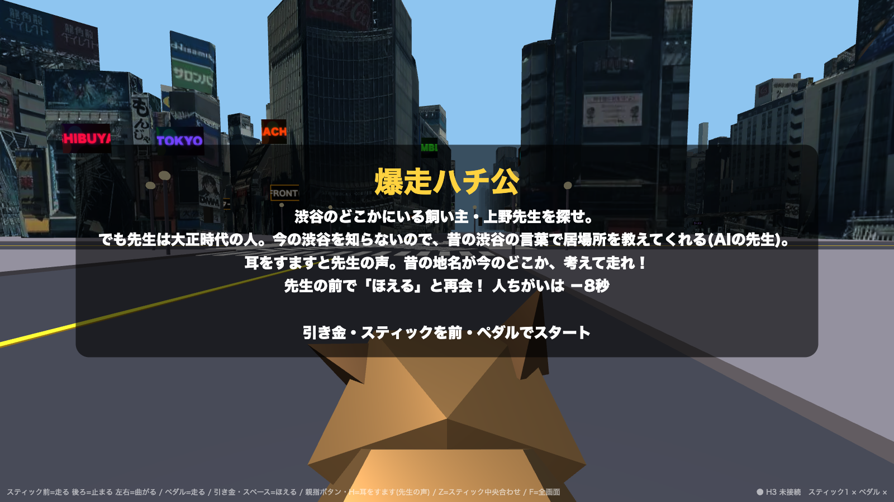

# 爆走ハチ公 (Bakuso HACHIKO)



渋谷の街を3Dで走るゲーム。
渋谷のどこかにいる飼い主・上野先生を探す。
先生は大正時代の人なので、昔の渋谷の言葉で居場所を教えてくれる(AIの先生)。
昔の地名が今のどこかを考えて走り、先生の前で「ほえる」と再会できる。
椅子が動く装置「DOF Reality H3」に乗って遊ぶ。
2026年10月4日のハッカソンで作成。

## 動かし方

```
pip install pyserial pygame
python3 bridge.py
```

ブラウザで http://localhost:8891 を開く。

- H3 がつながっていなくても、画面だけで遊べる
- 観戦用の画面: http://localhost:8891/watch
- スティック等の確認: http://localhost:8891/devices
- AIの仕掛けを使うときは、環境変数 `GEMINI_API_KEY` を設定する
  (なくても遊べる)

## 中身

- `bridge.py` … 画面と H3 の橋渡しをするサーバー
- `h3_direct.py` … H3 を USB で直接動かす
- `joy_reader.py` … スティック・ペダルを読む
- `web/index.html` … ゲーム本体
- `web/screen.html` … 観戦用モニター

## 使わせてもらったもの

- 3D都市モデル: 国土交通省 Project PLATEAU (CC BY 4.0)
  https://www.mlit.go.jp/plateau/
- three.js (MIT License)
